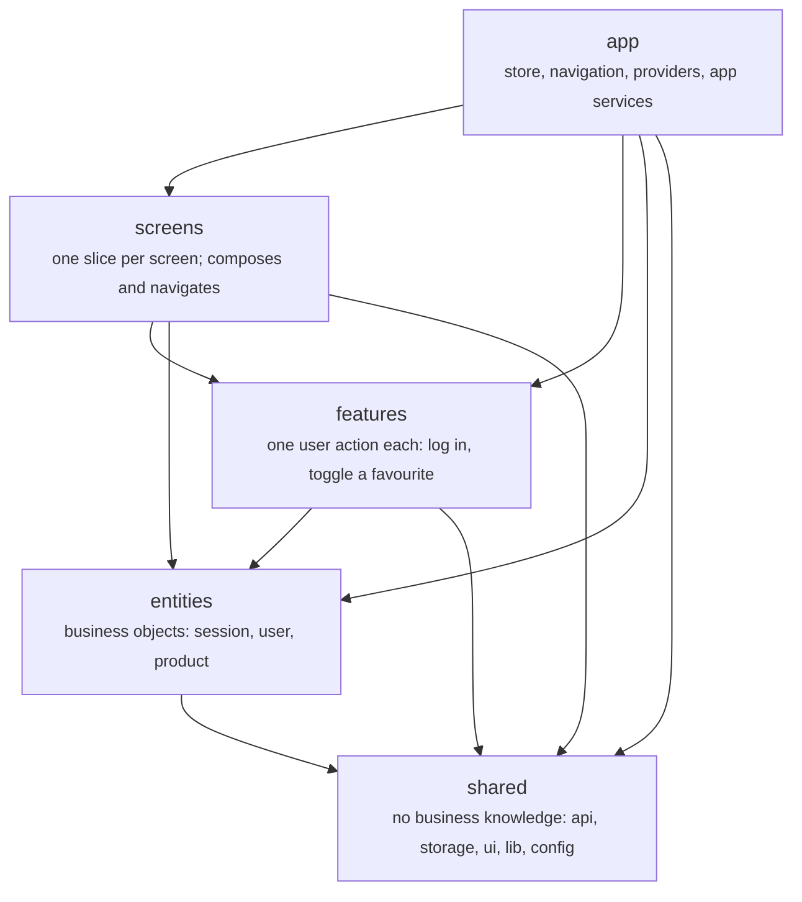
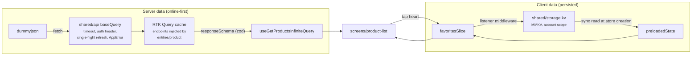
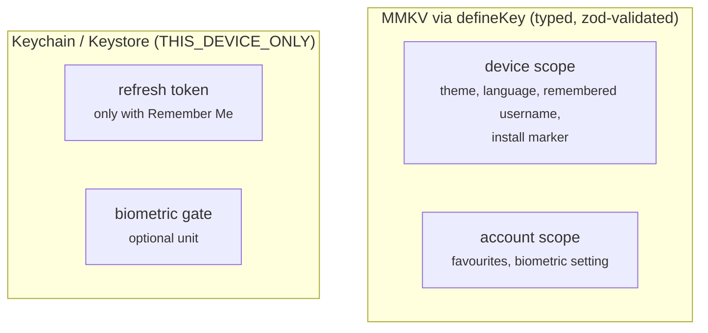
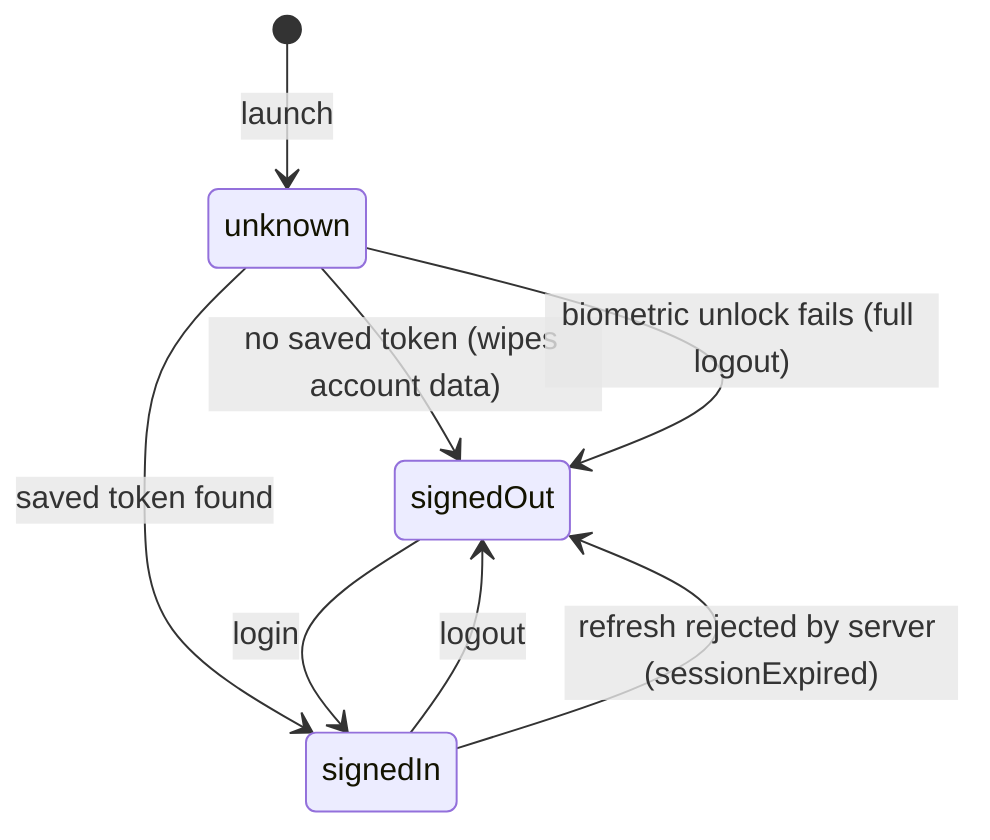
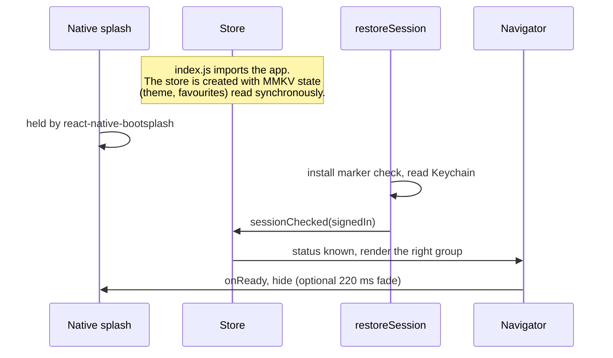

# Architecture

How RN Foundation is put together, and why. The reasons behind the larger choices are in
[docs/adr/](docs/adr/). The rules here are enforced by lint and tests, so this document describes what the code
already does.

## Layers

The code under `src/` is a trimmed [Feature-Sliced Design](https://feature-sliced.design/). Five layers, each
importing only from the layers below it:



| Layer      | Holds                                                                                                     | May import                 |
| ---------- | --------------------------------------------------------------------------------------------------------- | -------------------------- |
| `app`      | Store setup, the root navigator, providers, app-lifetime services (session restore, realtime), i18n setup | everything below           |
| `screens`  | One slice per screen. Composes features and entities, owns navigation for that screen                     | features, entities, shared |
| `features` | One user-facing action, with its UI, state and API calls                                                  | entities, shared           |
| `entities` | A business object: its schema, API endpoints, model logic and a display component                         | shared                     |
| `shared`   | Everything without business knowledge: HTTP, storage, UI kit, helpers, env config                         | shared                     |

Three rules hold across all layers:

1. **Downward only.** A layer never imports a layer above it.
2. **No sideways imports.** Two slices on the same layer never import each other: no feature imports a feature,
   no entity imports an entity. When two need each other, the layer above composes them. The products feature
   shows this: `ProductCard` (entity) takes an `action` slot, and the screen passes in `FavoriteButton` (feature).
3. **Public API only.** Code outside a slice imports it through its `index.ts`, never a file inside it.

`eslint-plugin-boundaries` enforces all three. `tools/boundary-fixtures/` holds a deliberately violating file for
each rule, and `tools/check-boundaries.js` asserts that lint reports exactly the expected rule on each one, so a
plugin upgrade that quietly weakens a rule fails CI. Lint runs in the pre-commit hook and in CI.

Lint also limits where some packages may be imported, so each one has a single owner:

| Package                           | Only in                                                                    |
| --------------------------------- | -------------------------------------------------------------------------- |
| `react-native-mmkv`               | `shared/storage/kv`                                                        |
| `react-native-keychain`           | `shared/storage/secure`                                                    |
| `@react-native-community/netinfo` | `shared/lib/network`                                                       |
| `@sentry/react-native`            | `app/monitoring`                                                           |
| `socket.io-client`                | `shared/api/socket`                                                        |
| `react-native-image-crop-picker`  | `shared/lib/media-picker`                                                  |
| `react-native-blob-util`          | `features/file-transfer`                                                   |
| `@react-navigation/*`             | not in `features` or `entities`                                            |
| AsyncStorage                      | nowhere; `tools/check-repo.js` also fails CI if it appears in the lockfile |

Entities and features never navigate. They take callbacks, and the screen decides where to go. Route params are
typed through React Navigation's global `RootParamList`, so a screen gets typed navigation without importing
`app`.

## Anatomy of a slice

```text
src/features/toggle-favorite/
├── index.ts              the public API; nothing else is importable from outside
├── model/                state, selectors, hooks, persistence (with tests next to them)
├── ui/                   components
├── api/                  RTK Query endpoints, injected into the shared baseApi
├── lib/                  pure helpers
└── i18n/en.ts            the slice's strings, registered by app/i18n
```

A slice has only the folders it needs. Each slice owns its strings, and `app/i18n` registers them, so deleting a
slice deletes its strings too.

## Data flow

The products unit is the reference for how a feature moves data. Server data and client data take different
paths.



- **Server data** lives in RTK Query. Entities inject their endpoints into `shared/api`'s `baseApi`, so `shared`
  never learns a business name. Every endpoint validates its response with a zod `responseSchema`; a mismatch
  becomes an `AppError` of kind `parse` rather than bad data in the UI.
- **Client data that must survive a restart** lives in a Redux slice. A listener middleware writes it to MMKV
  after each change. When the store is created, `app/store` reads it back synchronously into `preloadedState`, so
  the first frame already has it. There is no rehydration step and no loading gate. This replaces redux-persist
  ([ADR 0002](docs/adr/0002-state-and-persistence.md)).
- **Offline:** the app is online-first. The product list shows a retry state with no connection. Favourites keep
  the product summary, not just the ID, so the Favourites tab and a favourite's details screen work fully offline.
  A shared banner shows connection status.

### Errors

The base query turns every failure into one `AppError` union: `network`, `timeout`, `http`, `parse` or `unknown`.
`getErrorMessage` turns that into user-facing text. Each route has its own `ErrorBoundary`, so one broken screen
leaves the rest of the app usable. Unexpected errors go to `reportError` in `shared/lib/monitoring`, which forwards
to Sentry only when a DSN is configured ([ADR 0007](docs/adr/0007-crash-reporting.md)).

## Storage



Every MMKV value goes through `defineKey`, which declares a zod schema, a version, a **kind** and a **scope**:

| Kind    | Meaning             | Version change                                              |
| ------- | ------------------- | ----------------------------------------------------------- |
| `cache` | Disposable          | A miss; the value is deleted                                |
| `user`  | The user's own data | Runs `migrate`, or leaves the value on disk for a later fix |

| Scope     | Lives in            | Logout                    |
| --------- | ------------------- | ------------------------- |
| `device`  | the `device` store  | Survives                  |
| `account` | the `account` store | Wiped with one `clearAll` |

Unreadable or wrongly shaped data is a cache miss, never a crash. Secrets go to the Keychain only. Access tokens
stay in memory. With Remember Me on, the refresh token is persisted to the Keychain; with it off, nothing is
persisted and the session ends with the process.

`android:allowBackup` is `false` (checked in CI), so a restored backup can never pair MMKV data with Keystore keys
that no longer exist. On iOS the Keychain survives an uninstall, so an install marker in MMKV detects a fresh
install and clears any token left behind.

## Session lifecycle



- While the status is `unknown`, the native splash stays up and the navigator renders nothing, so the wrong screen
  never flashes.
- Navigation swaps the whole screen set by status (conditional groups), so after logout there is no signed-in
  screen in the history to go back to.
- **Every way out of a session wipes the same things:** the Redux state (the root reducer resets every slice,
  including ones added later), the RTK Query cache and its running queries, account-scope MMKV, the Keychain
  tokens, and anything a slice registered with `onSessionEnd` (the biometric gate, for example). Wipes are
  serialised, and sign-in waits for any wipe still running. `App.test.tsx` checks that nothing from one account
  reaches the next.
- **Token refresh** is single-flight: concurrent 401s share one refresh call. Only a server rejection (`4xx`) ends
  the session. A network failure or `5xx` leaves it intact for the next attempt.

## Boot sequence



## Optional units

Several parts of the foundation are optional: `products`, `biometric-unlock`, `splash-animation`, `media`,
`sentry`, `socket`, `date-time`, `phone-input`, `carousel`, `range-slider` and `image-viewer`.
[`units.json`](units.json) declares each unit's folders, packages and **touchpoints** (files outside its folders
that mention it), plus the units it `uses`. In touchpoints, the lines belonging to a unit are tagged:

```ts
import { FavoritesScreen } from '@screens/favorites'; // @unit:products

// @unit-start:products
Products: { screen: ProductListScreen },
// @unit-end:products
```

`scripts/create-app.js --remove <units>` deletes the folders, the tagged lines and the packages. It refuses a
touchpoint that has lost its marker, a tag on the last line of a wrapped statement, and the removal of a unit that
a kept unit `uses`. CI generates an app with every unit removed and builds it, so a missing tag fails CI
([ADR 0009](docs/adr/0009-optional-units.md)).

## Testing

| Level              | Tool                            | What it covers                                                                           |
| ------------------ | ------------------------------- | ---------------------------------------------------------------------------------------- |
| Unit and component | Jest, RNTL 14                   | Pure logic, slices, components in both themes. Co-located `*.test.ts(x)`                 |
| Integration        | Jest, the whole `<App />`       | Only the network is faked. Auth, Remember Me, logout wipe, deep links, products          |
| Architecture       | Boundary fixtures               | Each layer rule, by exact rule ID                                                        |
| Repo hygiene       | `tools/check-repo.js`           | No AsyncStorage, `allowBackup` off, no signing material or env file tracked              |
| Generated app      | CI `create-app` job             | An app with every unit removed typechecks, passes its tests and builds for Android       |
| Device             | Maestro (`.maestro/smoke.yaml`) | Login, products, favourites across a relaunch, gestures, deep links, logout. Run locally |

Coverage must stay at 70% or above for lines, branches, functions and statements.
